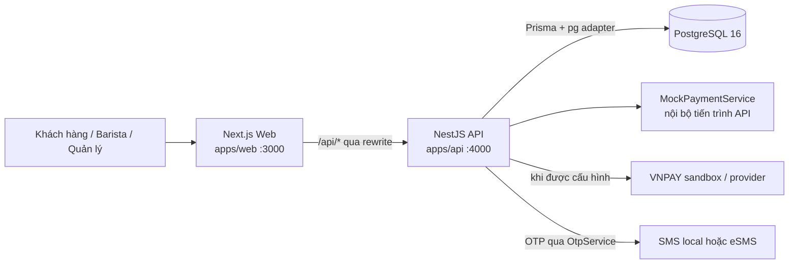
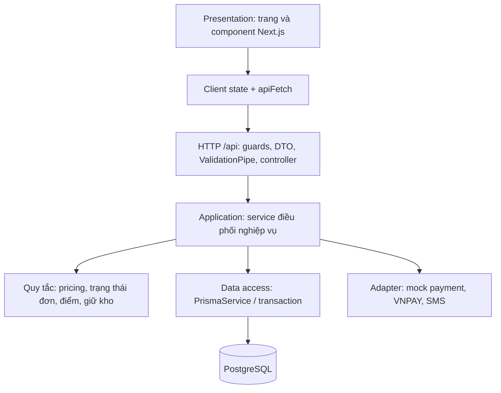

# Task 3.1 — Phương pháp và quyết định kiến trúc

**Dự án:** BrewLite A2

Tài liệu chọn cách trình bày **kiến trúc phân lớp**. Backend áp dụng **Modular Monolith**: một ứng dụng NestJS chia module theo nghiệp vụ, dùng chung PostgreSQL. Frontend Next.js được build và chạy riêng. Các mô tả “hiện tại” được đối chiếu với mã nguồn; phần PWA và cải tiến vận hành được ghi rõ là đề xuất.

## 1. Bối cảnh và tiêu chí lựa chọn

BrewLite phục vụ khách đặt đồ uống, barista xử lý đơn và quản lý tạo tài khoản nhân viên. Các luồng đặt hàng, giữ nguyên liệu, thanh toán và điểm thưởng cần nhất quán; giao diện ưu tiên điện thoại và vẫn hỗ trợ desktop.

Các quyết định được đánh giá theo khả năng hoàn thành phạm vi hai sprint, độ đơn giản khi chạy local, kiểm thử, tính nhất quán dữ liệu và chi phí thay đổi. Chưa có số liệu tải hoặc benchmark để cam kết số người dùng, độ trễ hay throughput.

## 2. Tổng thể hệ thống

Mock payment là một provider trong API, không phải container hay dịch vụ mạng riêng. VNPAY/eSMS là các tích hợp bên ngoài và không bắt buộc cho profile test local. Trong Compose, frontend gọi `http://api:4000/api`; trình duyệt gọi `/api` trên cùng origin với web. Xem [Compose](../../docker-compose.yml) và [cấu hình rewrite](../../apps/web/next.config.ts).

## 3. Các lớp và ranh giới nghiệp vụ

Đây là phân lớp logic, không phải mỗi lớp đều có một thư mục độc lập. Controller tiếp nhận HTTP; service kiểm tra quyền sở hữu và điều phối nghiệp vụ; DTO kiểm tra dữ liệu đầu vào; các helper chứa quy tắc dùng chung; Prisma thực hiện truy cập dữ liệu. NestJS đóng gói controller/provider bằng [module và cơ chế import/export](https://docs.nestjs.com/modules).

Hiện service truy cập trực tiếp `PrismaService`; một số helper nhận kiểu Prisma/transaction. Vì vậy hệ thống chưa áp dụng dependency inversion đầy đủ theo Clean Architecture. Tách repository/port chỉ nên thực hiện ở nơi có nhu cầu thay đổi hoặc kiểm thử cụ thể.

| Module / khu vực | Trách nhiệm | Mã nguồn |
| --- | --- | --- |
| Auth / Staff | Đăng ký, OTP, đăng nhập SĐT/email, JWT, Manager xem danh sách và cấp tài khoản BARISTA | [auth/](../../apps/api/src/auth/) |
| Products / Toppings | Thực đơn, size, topping, trạng thái bán chỉ MANAGER có thể bật/tắt | [products/](../../apps/api/src/products/) |
| Orders | Tạo/hủy đơn, lịch sử, trạng thái, điều phối giữ kho và thanh toán | [orders/](../../apps/api/src/orders/) |
| Payments | Thanh toán, replay, hoàn tiền, VNPAY return/IPN và đối soát | [payments/](../../apps/api/src/payments/) |
| Inventory / Recipes | Nguyên liệu, công thức, nhập/điều chỉnh kho, reservation và version | [inventory/](../../apps/api/src/inventory/) |
| Pricing / Promotions | Tính giá trên server, điều kiện voucher và quy tắc điểm | [pricing/](../../apps/api/src/common/pricing/), [promotions/](../../apps/api/src/promotions/) |
| Prisma / Health | Kết nối database theo vòng đời ứng dụng và kiểm tra kết nối | [prisma/](../../apps/api/src/prisma/), [health/](../../apps/api/src/health/) |

### Phân quyền và nghiệp vụ quản lý

Hệ thống sử dụng ba vai trò `CUSTOMER`, `BARISTA` và `MANAGER` trong enum `Role`. Mỗi người dùng được lưu ở bảng `User` thông qua trường `role`; không tạo bảng Manager riêng. Phân quyền được kiểm tra ở backend bằng JWT guard và `RolesGuard`, kết hợp với kiểm tra quyền sở hữu dữ liệu tại service. Manager được cấp quyền thực hiện các nghiệp vụ nhân viên tại những endpoint khai báo cả `BARISTA` và `MANAGER`; không giả định quyền được kế thừa tự động từ enum.

| Nhóm chức năng | Phân quyền và cách hiện thực |
| --- | --- |
| Quản lý nhân viên | Chỉ `MANAGER` được gọi `GET /api/admin/staff` để xem danh sách phân trang và `POST /api/admin/staff` để tạo tài khoản `BARISTA`. Thông tin danh sách được giới hạn ở các trường cần thiết; tài khoản nhân viên do quản lý cấp được đánh dấu xác minh số điện thoại theo luồng hiện thực. |
| Bật/tắt bán sản phẩm | `PATCH /api/products/:id/status` chỉ dành cho `MANAGER`. |
| Nghiệp vụ quầy và kho | Các endpoint được khai báo `@Roles('BARISTA', 'MANAGER')` cho phép cả nhân viên và quản lý thao tác theo quyền được cấp. |
| Giao diện quản lý | Trang `/manager` hỗ trợ tạo và xem nhân viên; quản lý có thể truy cập các màn hình quầy được cho phép qua `AuthGate`. |

Mọi vai trò vẫn dùng chung ứng dụng Next.js, NestJS và PostgreSQL; thay đổi RBAC không làm phát sinh môi trường triển khai riêng. Các thành phần liên quan: [StaffController](../../apps/api/src/auth/staff.controller.ts), [ProductsController](../../apps/api/src/products/products.controller.ts), [RolesGuard](../../apps/api/src/common/guards/roles.guard.ts), [màn hình Manager](../../apps/web/src/app/manager/page.tsx), [danh sách nhân viên](../../apps/web/src/components/manager/staff-list.tsx). Quyết định và đánh đổi bảo mật được trình bày trong [ADR 008](adr/008-jwt-otp-rbac.md).

Các module gọi provider nội bộ qua dependency injection. `OrdersService` hiện dùng `PaymentsService`; logic điểm nằm trong helper của Orders, không có một `LoyaltyModule` độc lập. Ranh giới module cần được giữ khi mở rộng để tránh service phụ thuộc chéo quá nhiều.

## 4. Frontend Next.js và phương án PWA

- **Hiện tại:** Next.js App Router, React và TypeScript; trang/component chia theo luồng khách hàng, xác thực, barista và quản lý. Giao diện responsive dùng tông sáng cố định.
- **Trạng thái client:** Zustand cho giỏ hàng và phiên đăng nhập; các helper quản lý hydration, lưu trữ và checkout đang chờ. Token có đường lui lưu trong bộ nhớ khi browser storage bị từ chối. [Stores](../../apps/web/src/store/), [auth-session](../../apps/web/src/lib/auth-session.ts).
- **Giao tiếp API:** `apiFetch` dùng `fetch`, gắn Bearer token, timeout và chuẩn hóa lỗi. Timeout thanh toán không đồng nghĩa gateway từ chối; client không tự retry mutation bằng một khóa mới. [API client](../../apps/web/src/lib/api/client.ts).
- **Nguồn dữ liệu chính:** giá, trạng thái đơn, tồn kho và số dư điểm do backend xác nhận. Giá trên giao diện là thông tin hiển thị, không phải đầu vào tin cậy để ghi đơn.

**Trạng thái PWA:** repo hiện chưa có manifest và luồng đăng ký service worker mới. `LegacyPwaCleanup` cùng `/sw.js` dùng để gỡ worker/cache cũ, không cung cấp offline checkout. Vì vậy bản hiện tại được mô tả là web responsive, chưa nghiệm thu là PWA đầy đủ. Xem [cleanup](../../apps/web/src/lib/legacy-pwa-cleanup.ts) và [retirement worker](../../apps/web/public/sw.js).

**Phương án đề xuất:** bổ sung manifest/icons và khả năng cài đặt; nếu dùng service worker, chỉ cache tài nguyên giao diện phù hợp. Request xác thực, đơn hàng, tồn kho và thanh toán phải lấy dữ liệu mới từ server; khi offline hiển thị trạng thái mất kết nối và giữ bản nháp giỏ, không gửi thanh toán nền. Điều kiện nghiệm thu và trade-off nằm trong [ADR 006](adr/006-pwa-strategy.md), tham chiếu [hướng dẫn PWA của Next.js](https://nextjs.org/docs/app/guides/progressive-web-apps).

## 5. PostgreSQL và cơ chế migration

PostgreSQL 16 lưu các quan hệ User–Order–OrderItem, Payment/Refund, sổ điểm, khuyến mãi và nguyên liệu/công thức. `User.id` là khóa chính số nguyên; phone/email là trường unique có thể null. `Ingredient.version` phục vụ kiểm soát cập nhật kho; không giả định `Order` có cột version. Định nghĩa và ràng buộc nằm trong [schema](../../apps/api/prisma/schema.prisma) và [SQL migrations](../../apps/api/prisma/migrations/).

Prisma 6 sử dụng `@prisma/adapter-pg`, client được generate vào `src/generated/prisma`. Mã generated không đưa vào Git và phải tạo trước lint/type-check/build API.

| Mục đích | Lệnh tại root repo |
| --- | --- |
| Tạo Prisma Client | `npm.cmd --prefix apps/api run prisma:generate` |
| Tạo migration khi phát triển | `npm.cmd --prefix apps/api run prisma:migrate:dev -- --name <ten_thay_doi>` |
| Áp dụng migration đã lưu | `npm.cmd --prefix apps/api run prisma:migrate:deploy` |
| Nạp dữ liệu mẫu local | `npm.cmd --prefix apps/api run prisma:seed` |

`migrate dev` dùng cho phát triển; `migrate deploy` áp dụng các migration đã có. Đây cũng là sự phân biệt trong [hướng dẫn Prisma Migrate](https://www.prisma.io/docs/orm/prisma-migrate/workflows/development-and-production). Trong Compose, `api-init` chạy migration rồi seed trước khi API mở; Dockerfile API tự generate/build nhưng không tự migrate khi gọi trực tiếp `node dist/main.js`.

Tạo đơn và các lần cập nhật trạng thái liên quan được đặt trong transaction. `lockOrder` khóa dòng đơn; `inventoryTransaction` xử lý một số xung đột version/deadlock bằng retry toàn transaction. Cuộc gọi gateway bên ngoài không được coi là có thể rollback cùng PostgreSQL. Xem [khóa đơn](../../apps/api/src/orders/order-lock.ts) và [transaction kho](../../apps/api/src/inventory/transaction.ts).

## 6. Thanh toán mô phỏng và xử lý lỗi mạng

`PaymentsService` điều phối nghiệp vụ; `MockPaymentService` giả lập WALLET/CARD, còn `VnpayGateway` là abstraction cho adapter VNPAY.

| Trường hợp | Hành vi hiện tại |
| --- | --- |
| `mockResult: FAILED` | Mock trả thất bại và lý do từ chối. |
| Mock không bị ép thất bại | Mock trả thành công với mã `MOCK-WALLET-*` hoặc `MOCK-CARD-*`. |
| WALLET/CARD khi mock bị tắt | API từ chối phương thức thử nghiệm. |
| VNPAY | Cần cấu hình provider; tạo phiên thanh toán, xử lý chữ ký/callback và đối soát theo gateway. |

Hành vi được định nghĩa trong [MockPaymentService](../../apps/api/src/payments/mock-payment.service.ts). `PAYMENT_MOCK_ENABLED` điều khiển quyền dùng mock; profile Postman bật mock trong tiến trình test riêng.

Luồng thanh toán gồm ba phần: xác nhận/ghi nhận yêu cầu trong database → gọi adapter ngoài phần transaction đó → lưu kết quả dưới khóa đơn. Trường hợp response bị mất hoặc gateway chưa xác định được kết quả cần replay/đối soát; không khẳng định cơ chế này bảo đảm exactly-once với mọi nhà cung cấp bên ngoài.

- `POST /api/payments` yêu cầu idempotency key qua body hoặc header; đối chiếu cả chủ đơn và hash nội dung khi replay.
- `POST /api/orders` hỗ trợ key; frontend luôn gửi, nhưng API hiện vẫn nhận đơn không có key. Khi đó không có bảo vệ replay tạo đơn theo key.
- Cùng key/nội dung trả kết quả đã ghi; dùng lại key với nội dung khác bị từ chối. Client giữ nguyên key/body khi kết quả còn chưa rõ.
- Máy trạng thái chặn chuyển trạng thái không hợp lệ; transaction phối hợp thay đổi thanh toán, kho và điểm trong phạm vi database.

Tham chiếu: [PaymentsService](../../apps/api/src/payments/payments.service.ts), [OrdersService](../../apps/api/src/orders/orders.service.ts), [checkout-flow](../../apps/web/src/lib/checkout-flow.ts), [ADR 005](adr/005-payment-mock-idempotency.md).

## 7. Logging, health check và cấu hình

| Khía cạnh | Hiện thực | Giới hạn / hướng mở rộng |
| --- | --- | --- |
| Logging | Nest `Logger`, log lỗi ngoài dự kiến ở `AllExceptionsFilter`; log lỗi các job đối soát/hết hạn. Xem bằng `docker compose logs -f api web`. | Chưa có request ID xuyên suốt, request access log có cấu trúc hoặc hệ thống metrics/tracing tập trung. |
| Lỗi HTTP | Response có `statusCode`, `code`, `message`, `details?`, `path`, `timestamp`; lỗi ngoài dự kiến không trả stack cho client. | Cần tiếp tục kiểm soát dữ liệu nhạy cảm trong log khi thêm endpoint/provider. |
| Health | `GET /api/health` chạy `SELECT 1`; bình thường trả `{ "status": "ok", "db": "up" }`. Compose dùng health check để chờ dịch vụ. | Kiểm tra kết nối DB, không xác nhận gateway/SMS hoạt động; chưa tách liveness/readiness. |
| Cấu hình API | Nest `ConfigModule`/`ConfigService`, biến môi trường và file `.env` local; `.env.example` là mẫu. | Kiểm tra cấu hình đang nằm ở từng nơi sử dụng; chưa có schema validate toàn bộ biến lúc bootstrap. |
| Cấu hình frontend | `BACKEND_API_URL` dùng cho Next rewrite; trong Docker là `http://api:4000/api`. | Rewrite được đưa vào bản build; đổi URL phải build lại. Không có UI đổi server động. |
| Môi trường test | `TEST_DATABASE_URL` tách database chính; Postman dùng cổng 4001, secret riêng, SMS local và mock payment. | CI hiện chạy lint/unit test/build; E2E database không nằm trong workflow CI hiện tại. |

Mã nguồn: [exception filter](../../apps/api/src/common/filters/all-exceptions.filter.ts), [health](../../apps/api/src/health/health.controller.ts), [cấu hình mẫu](../../apps/api/.env.example), [Postman launcher](../../scripts/postman/start-postman.mjs), [CI](../ci.md).

## 8. Lý do chọn, ưu điểm và trade-off

| Quyết định | Lợi ích cho BrewLite A2 | Hạn chế chấp nhận / phương án khác |
| --- | --- | --- |
| Monorepo, hai app riêng | Một PR có thể chứa cả thay đổi API, web và tài liệu; chạy cùng Compose. | Hai bộ dependencies/lockfile cần bảo trì. Polyrepo phù hợp khi cần tách quyền/vòng đời phát hành rõ hơn. |
| Modular Monolith + phân lớp | Ít thành phần vận hành; gọi nội bộ và transaction database thuận tiện. | Module chia sẻ tiến trình/database; lỗi tiến trình ảnh hưởng toàn API. Chuyển sang dịch vụ độc lập sẽ cần thiết kế lại ranh giới dữ liệu và phục hồi lỗi mạng. |
| Service truy cập Prisma | Giảm số adapter/interface cần duy trì, kiểm tra kiểu truy vấn khi build. | Nghiệp vụ phụ thuộc ORM. Ports/adapters có thể tăng khả năng thay thế ở ranh giới cần thiết, nhưng thêm lớp mã. Clean Architecture và monolith không loại trừ nhau. |
| Next.js + Zustand | Chia sẻ giỏ/phiên giữa trang, phục hồi lựa chọn trên trình duyệt; một giao diện cho mobile và desktop. | Phải xử lý hydration, đổi tài khoản và dữ liệu client cũ; storage không phải nguồn tin cậy. |
| Mock payment + adapter gateway | Demo và test lặp lại được; không cần giao dịch thật cho mỗi ca kiểm thử. | Kết quả mock không chứng minh sandbox/production đạt; callback, timeout và đối soát vẫn cần kiểm tra riêng. |

Nếu phải chạy nhiều replica API, cần đánh giá pool database, việc các job timer chạy trên từng replica và cơ chế phối hợp worker. Chưa có queue/scheduler độc lập hay kết quả load test để kết luận khả năng scale. Nếu triển khai public, cần hoàn thiện TLS, cấu hình CORS theo origin thực, chính sách log và sao lưu; các nội dung này chưa được xem là đã triển khai cloud.

## 9. Danh mục ADR và đối chiếu yêu cầu

Các ADR ghi nhận quyết định kiến trúc, phương án thay thế và hệ quả đối với hệ thống BrewLite A2.

| ADR | Quyết định |
| --- | --- |
| [001](adr/001-monorepo.md) | Monorepo với hai ứng dụng và lockfile riêng |
| [002](adr/002-modular-layered-backend.md) | Backend chia module nghiệp vụ và phân lớp |
| [003](adr/003-postgresql-prisma-migrations.md) | PostgreSQL, Prisma và migration có phiên bản |
| [004](adr/004-nextjs-client-state.md) | Next.js mobile-first, Zustand và HTTP client |
| [005](adr/005-payment-mock-idempotency.md) | Mock payment, adapter và idempotency |
| [006](adr/006-pwa-strategy.md) | Hiện trạng retirement và phương án PWA đề xuất |
| [007](adr/007-logging-health-configuration.md) | Logging, health check và biến môi trường |
| [008](adr/008-jwt-otp-rbac.md) | JWT, OTP và phân quyền phía server |
| [009](adr/009-vercel-render-delivery.md) | Phương án CD Vercel/Render đã cấu hình, chờ nghiệm thu cloud |

| Yêu cầu Task 3.1 | Vị trí đáp ứng |
| --- | --- |
| Trình bày theo kiến trúc phân lớp | Mục 2–3, ADR 002 |
| Frontend Next.js/PWA | Mục 4, ADR 004 và ADR 006; PWA đầy đủ là đề xuất |
| Backend NestJS theo module/domain và RBAC Manager | Mục 3, ADR 002 và ADR 008 |
| PostgreSQL và migration | Mục 5, ADR 003 |
| Dịch vụ thanh toán mô phỏng | Mục 6, ADR 005 |
| Logging, health check, cấu hình | Mục 7, ADR 007 |
| Lý do chọn, ưu điểm, hạn chế, trade-off | Mục 8 và phần hệ quả trong từng ADR |

Các mô tả kiến trúc được liên kết với mã nguồn và các ADR tương ứng để thuận tiện cho việc kiểm tra và bảo trì.
