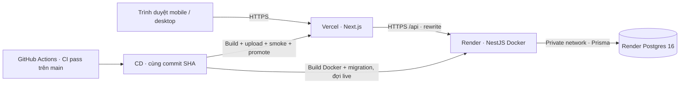

# CD và triển khai BrewLite A2

## Mô hình triển khai

Frontend Next.js chạy trên **Vercel**, API NestJS chạy bằng Docker trên **Render**, PostgreSQL 16 dùng Render Postgres cùng region. Trình duyệt gọi `/api/*` cùng origin với frontend; Next.js rewrite đến `BACKEND_API_URL`. API giữ nguyên mô hình module và các job trong tiến trình.



Đây là **cấu hình triển khai đã chuẩn bị**, chưa có project/URL hoặc lượt CD cloud thành công được xác nhận. Sơ đồ trên mô tả phương án này, chưa thay thế UML Deployment Diagram của Task 3.2.

## 1. Đưa cấu hình lên GitHub

Tạo PR cho các file cấu hình, đợi `CI (api)` và `CI (web)` đạt rồi merge vào `main`. CD dùng `workflow_run`, nên workflow phải có trên nhánh mặc định mới nhận được sự kiện CI. Khi chưa điền cấu hình cloud, CD sẽ dừng với tên biến bị thiếu; không ảnh hưởng kết quả CI.

## 2. Tạo API và database trên Render

1. Đăng nhập [Render Dashboard](https://dashboard.render.com/) bằng GitHub, chọn **New → Blueprint**, kết nối repo BrewliteA2 và chọn nhánh `main`.
2. Đặt **Blueprint Path** là `scripts/deploy/render.yaml`. Kiểm tra API và database đều dùng **Free**, region **Singapore**, rồi tạo tài nguyên.
3. Blueprint tự nối `DATABASE_URL` qua mạng nội bộ, sinh hai secret JWT/OTP riêng, dùng Dockerfile API và health check `/api/health`. `start-cloud.sh` chạy `prisma migrate deploy` trước khi mở API; lỗi migration sẽ chặn khởi động.
4. Nếu cần dữ liệu trình diễn trên database mới, đặt **SEED_DEMO_DATA=true** trong Environment của API và deploy một lần, sau đó đổi về **false**. Seed tạo menu, kho giả định, voucher và tài khoản mẫu trong [README](../README.md#tài-khoản-mẫu). Đây là dữ liệu demo; không dùng cho cửa hàng thật.
5. Đợi API live, lưu URL dạng `https://<ten-api>.onrender.com`. Kiểm tra `https://<ten-api>.onrender.com/api/health` trả `status=ok`, `db=up`.
6. Lấy **Service ID** (`srv-…`) trong trang API và tạo **API key** ở Account Settings để dùng cho GitHub CD. **Auto-Deploy** để **Off**: workflow sẽ gửi đúng commit đã qua CI, không tự deploy mọi push.

Blueprint bật thanh toán **mô phỏng** để demo, tắt OTP cố định và seed manager local. Đăng nhập email bằng tài khoản seed dùng được; đăng ký SĐT/OTP cần cấu hình `ESMS_API_KEY`, `ESMS_SECRET_KEY`, `ESMS_BRANDNAME`, `ESMS_OTP_TEMPLATE` có `{OTP}`. Nếu dùng VNPAY, bổ sung cấu hình provider và `VNPAY_RETURN_URL=https://<domain-web>/payment/vnpay-return`; cấu hình IPN theo [mã tích hợp VNPAY](../apps/api/src/payments/vnpay/).

**Giới hạn Free:** API ngủ sau 15 phút không có request, nên lần đầu truy cập có thể chậm; các job timer không chạy trong lúc ngủ. Free Postgres hết hạn sau 30 ngày và không có backup. Bản mẫu phù hợp demo bài tập; khi cần chạy liên tục phải chọn gói phù hợp và thiết lập backup. Xem [giới hạn Render Free](https://render.com/docs/free).

## 3. Tạo frontend trên Vercel

Trong [Vercel New Project](https://vercel.com/new), import repo và cấu hình:

| Thiết lập | Giá trị |
| --- | --- |
| Framework Preset | Next.js |
| Root Directory | **apps/web** |
| Node.js Version | **24.x** |
| Install / Build | `npm ci` / `npm run build` (đã có trong `apps/web/vercel.json`) |
| Production Branch | `main` |
| Environment Variable | `BACKEND_API_URL=https://<ten-api>.onrender.com/api` |

Đặt biến API cho môi trường **Production**; nếu deploy preview thủ công, đặt cho **Preview** nữa. Biến này chỉ dùng phía server, không cần tiền tố `NEXT_PUBLIC_`. Vercel không thể dùng `localhost:4000` hay tên service Docker `api` trên máy cá nhân. Đổi URL API cần build lại web.

Lần tạo project có thể có một deployment khởi tạo. Sau đó `git.deploymentEnabled=false` ngăn Vercel tự deploy mỗi push; GitHub CD đảm nhiệm bước phát hành sau CI. Khi khởi tạo xong, lấy **Project ID** ở Project Settings → General và **Team/Org ID** ở Settings của tài khoản/team. Tạo token tại [Vercel Tokens](https://vercel.com/account/tokens), giới hạn vào team cần triển khai.

Nếu bật Deployment Protection cho deployment URL, tạo **Protection Bypass for Automation** và lưu secret vào GitHub theo bảng bên dưới; smoke test không tự bỏ qua trang đăng nhập Vercel. Xem [GitHub Actions của Vercel](https://vercel.com/docs/git/vercel-for-github#using-github-actions).

## 4. Cấu hình GitHub Actions

Vào repository **Settings → Environments → New environment**, tạo `production`. Đặt các giá trị dưới đây vào **Environment variables** và **Environment secrets** tương ứng; không ghi secret vào file repo/chat.

| Loại | Tên | Giá trị |
| --- | --- | --- |
| Variable | `BACKEND_API_URL` | URL HTTPS của API, có `/api`, trùng cấu hình Vercel |
| Variable | `VERCEL_ORG_ID` | Team/Org ID của Vercel |
| Variable | `VERCEL_PROJECT_ID` | Project ID frontend |
| Variable | `RENDER_SERVICE_ID` | Service ID của API (`srv-…`) |
| Secret | `VERCEL_TOKEN` | Token triển khai Vercel |
| Secret | `RENDER_API_KEY` | API key của Render |
| Secret, khi cần | `VERCEL_AUTOMATION_BYPASS_SECRET` | Secret automation bypass cho Deployment Protection |

Nếu API được vận hành riêng, có thể bỏ `RENDER_SERVICE_ID`/`RENDER_API_KEY`; CD chỉ kiểm tra API và triển khai web. Với phương án Render trong tài liệu này, điền cả hai để API và web phát hành cùng SHA. Database URL, JWT, OTP và thông tin SMS/VNPAY chỉ nằm ở Render, không đặt trong frontend.

## 5. Luồng CD và kiểm tra sau deploy

[Workflow CD](../.github/workflows/cd.yml) thực hiện:

1. Nhận CI thành công trên `main`, checkout đúng SHA; xác nhận CI mới nhất của SHA đó đạt. Lượt cũ bị bỏ qua nếu `main` đã thay đổi. Chạy thủ công cũng phải chọn `main` và có CI thành công trước đó.
2. Nếu cấu hình Render, yêu cầu deploy đúng SHA, đợi deploy đó **live** và xác nhận commit; build/migration lỗi sẽ chặn triển khai web.
3. Kiểm tra API health, kết nối database và danh sách sản phẩm.
4. Pull cấu hình project Vercel, kiểm tra Root Directory, build bằng CLI đã pin phiên bản, upload output với `--prebuilt --prod --skip-domain`.
5. Kiểm tra HTML trang chủ, `/api/health` và `/api/products` qua deployment URL. Chỉ khi đạt mới **promote** sang production domain. Workflow Summary lưu SHA và deployment URL.

CD không hủy release đang chạy khi có commit mới. API được cập nhật trước web, nên migration/API phải tương thích với frontend cũ trong khoảng chuyển phiên bản. Nếu smoke test web thất bại, domain web cũ vẫn giữ nguyên, nhưng API/migration đã có thể được cập nhật; workflow không tự rollback database.

Sau khi cấu hình xong, chọn **Actions → CI → Run workflow → main**, đợi CI và CD hoàn tất. Có thể chạy lại **CD → Run workflow → main** khi cần; workflow luôn kiểm tra CI.

Kiểm tra thủ công tại root:

```powershell
node scripts/deploy/smoke.mjs https://<ten-api>.onrender.com/api --api-only
node scripts/deploy/smoke.mjs https://<domain-web>.vercel.app
node --test tests/deployment/*.test.mjs
```

Smoke test chỉ đọc dữ liệu, chấp nhận database chưa có món; để nghiệm thu demo cần kiểm tra thêm đăng nhập, menu, giỏ, đặt món, thanh toán mock và luồng barista trên mobile/desktop. Xem log runtime ở Vercel/Render; log pipeline ở GitHub Actions. Chỉ ghi URL và trạng thái Done vào backlog sau khi có lượt cloud thực sự thành công.

## Rollback và Docker local

Web: dùng Vercel rollback/promote deployment đã chạy tốt. API: dùng Render Dashboard chọn deployment trước và kiểm tra lại health/luồng nghiệp vụ. Việc rollback ứng dụng không đảo ngược migration; ưu tiên migration tương thích ngược và bản sửa tiếp theo, khôi phục database từ backup khi thật sự cần.

Docker local vẫn chạy bằng `docker compose up --build -d`, với service `db`, `api-init`, `api`, `web`. `api-init` migrate/seed cho local; `docker compose stop` dừng và giữ volume. Hướng dẫn local nằm trong [README](../README.md#chạy-bằng-docker).

Tham chiếu cấu hình: [Render Blueprint](https://render.com/docs/blueprint-spec), [Render deploy theo commit](https://api-docs.render.com/reference/create-deploy), [Vercel CLI build](https://vercel.com/docs/cli/build), [Vercel Git deployment control](https://vercel.com/docs/project-configuration/git-configuration#gitdeploymentenabled).
