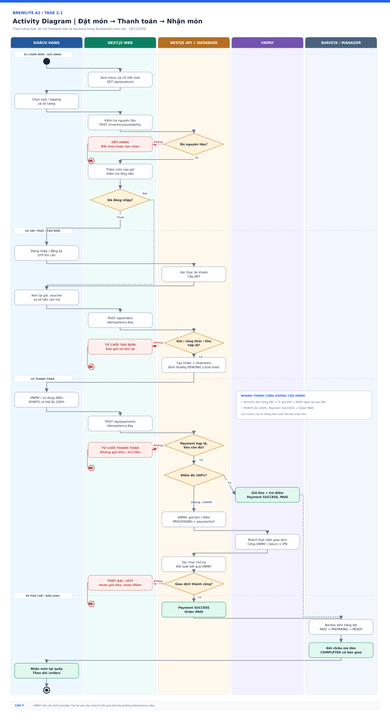

# Task 2.1 — UML Activity Diagram: Đặt đồ uống end-to-end

**Bộ source đối chiếu:** `BrewliteA2-main.zip` (snapshot `main`, SHA `047aa6c`; ngày đóng ZIP 14/11/2026). **Trạng thái:** đặc tả luồng theo code, chưa khẳng định tất cả tình huống đã test thành công trên production.
**File sơ đồ:** [SVG](./activity-end-to-end.svg) · [PlantUML](./activity-end-to-end.puml).

## 1. Ranh giới và swimlane

| Swimlane | Trách nhiệm đọc được từ source |
| --- | --- |
| Khách hàng | Xem menu, chọn món, đăng nhập/OTP khi cần, chỉnh giỏ, dùng voucher/điểm, xác nhận thanh toán và nhận món. |
| Next.js Web | `apps/web`: menu → product modal → cart → checkout → orders; giữ phiên checkout trong sessionStorage; dùng `apiFetch` và `CheckoutFlow` để gửi yêu cầu. |
| NestJS / PostgreSQL | Xác thực; định giá server; kiểm tra recipe/tồn; tạo Order; claim payment theo idempotency; reserve/release kho; cập nhật trạng thái. |
| VNPAY (bên ngoài) | Trang thanh toán, IPN và phản hồi giao dịch; NestJS xác thực chữ ký và có xử lý đối soát. |
| Nhân viên quầy | Màn `/barista`: nhận đơn PAID, chuyển PREPARING → READY → COMPLETED và bàn giao. |

## 2. Luồng được xác nhận từ code

1. **Menu / giỏ:** `GET /api/products` và chi tiết sản phẩm. Product modal gọi `POST /api/inventory/availability` cho tổ hợp size/topping; `addItemChecked` kiểm tra trước khi thêm. Nếu hết hàng phải đổi lựa chọn; không giả định frontend tự nhận đơn hết nguyên liệu.
2. **Đăng nhập:** khi khách chưa đăng nhập và bấm chọn món, UI điều hướng `/login?redirect=...`; checkout cũng bảo vệ phiên. Đăng ký có luồng OTP; tạo đơn yêu cầu JWT.
3. **Tạo đơn:** `CheckoutFlow.prepare` gửi `POST /api/orders` kèm **Idempotency-Key**. Backend kiểm tra dữ liệu, giá, promo và nguyên liệu trong transaction. Thông thường tạo **PENDING và chưa giữ kho**. Riêng đơn có mã giảm giá hợp lệ khiến `total === 0` có thể giữ kho và chuyển **PAID ngay tại bước tạo đơn**.
4. **Thanh toán theo giao diện mới:** Checkout hiện **VNPAY** cho phần phải trả và cho phép sử dụng điểm thưởng. Nếu điểm trả đủ 100%, frontend gửi method **POINTS**; nếu còn tiền, gửi **VNPAY**. Phương thức **WALLET/CARD mô phỏng có trong backend** nhưng không phải lựa chọn đang hiển thị trong checkout mới.
5. **VNPAY:** `POST /api/payments` kiểm tra và **hold nguyên liệu trước khi trả paymentUrl**; ghi Payment `PROCESSING`; trình duyệt điều hướng sang VNPAY. Return/IPN/query được kiểm tra ở backend. Thành công → Payment `SUCCESS`, Order `PAID`; thất bại/hủy → giải phóng phần hold, hoàn điểm đã giữ và, nếu phù hợp, chuyển Order `PAYMENT_FAILED`.
6. **POINTS 100%:** Payment ghi `SUCCESS`, hệ thống hold kho và chuyển Order `PAID` ngay trong transaction, không cần sang cổng VNPAY.
7. **Bàn giao:** Barista nhìn `GET /api/orders/active`, cập nhật `PATCH /api/orders/:id/status`: `PAID → PREPARING → READY → COMPLETED`. Khách xem `/orders` và nhận đồ uống.

## 3. Nhánh ngoại lệ và nguyên tắc retry

| Nhánh | Code / quy tắc |
| --- | --- |
| Hết hàng trước khi thêm giỏ | Frontend `product-modal.tsx` + `checkInventory`; không cho thêm quá lượng khả dụng. |
| Thiếu nguyên liệu / giá hoặc promo không hợp lệ khi tạo đơn | `OrdersService.createAttempt` từ chối trong transaction, báo để khách điều chỉnh. |
| Thiếu kho lúc khởi tạo payment VNPAY/POINTS | `PaymentsService.processPayment` từ chối; việc claim, giữ điểm và hold kho được rollback atomically; **không mặc định gắn PAYMENT_FAILED cho lỗi validation này**. |
| VNPAY thất bại, hủy, hết hạn | `PaymentsService.settlePayment` và job đối soát xử lý kết quả; hoàn lượng/điểm giữ khi thích hợp; Order `PAYMENT_FAILED` nếu không còn payment hoạt động khác. |
| Mất phản hồi request tạo đơn/thanh toán | `CheckoutFlow` lưu key + payload trước khi gửi; với kết quả chưa rõ, **retry cùng key**. Với thất bại đã xác định, lượt thanh toán mới dùng key mới. |
| Khách chủ động hủy đơn | UI checkout có nút hủy; API `POST /api/orders/:id/cancel`. Ngoài đường chính, có điều kiện trạng thái và xử lý hoàn tương ứng. |

**Giới hạn:** VNPAY cần được cấu hình thực tế; source có `VNPAY_NOT_CONFIGURED` khi thiếu cấu hình. Bản này mô tả luồng *khi provider sẵn sàng*, không cam kết VNPAY đang giao dịch thành công. `/sw.js` hiện là worker gỡ PWA cũ, không được diễn giải là đã có checkout offline.

## 4. Trace về file thực tế

| Khâu | File / endpoint |
| --- | --- |
| Menu / chọn size/topping | `apps/web/src/app/(shop)/menu/page.tsx`; `apps/web/src/components/products/product-modal.tsx`; `apps/web/src/lib/api/inventory.ts` |
| Cart / Checkout | `apps/web/src/store/cart-store.ts`; `apps/web/src/app/(shop)/cart/page.tsx`; `apps/web/src/app/(shop)/checkout/page.tsx` |
| Phiên / Idempotency | `apps/web/src/lib/checkout-flow.ts`; `apps/web/src/lib/api/client.ts` |
| OTP/login | `apps/web/src/app/(auth)/login/page.tsx`; `apps/api/src/auth/auth.controller.ts` |
| Order | `apps/api/src/orders/orders.controller.ts`; `apps/api/src/orders/orders.service.ts` |
| Payment VNPAY / POINTS / mock | `apps/api/src/payments/payments.controller.ts`; `apps/api/src/payments/payments.service.ts`; `apps/api/src/payments/vnpay/vnpay.gateway.ts` |
| Kho | `apps/api/src/inventory/inventory.service.ts` (`hold`/`finish`); `apps/api/src/inventory/transaction.ts` |
| Return VNPAY | `apps/web/src/app/payment/vnpay-return/page.tsx` |
| Barista & trạng thái | `apps/web/src/app/barista/page.tsx`; `apps/api/src/orders/order-state.ts` |

**Đối chiếu với SRS:** `docs/requirements/srs.md` vẫn mô tả WALLET/CARD mock là yêu cầu MVP, trong khi checkout mới chỉ hiển thị VNPAY/POINTS. Đây là **độ lệch giữa tài liệu yêu cầu và giao diện**, cần thống nhất trước nghiệm thu; sơ đồ này ưu tiên phản ánh hành vi code hiện hành.

> **Bản trình bày cập nhật:** sơ đồ SVG được bố cục lại theo nhóm bước để đọc rõ hơn, giữ nguyên logic đã đối chiếu. Tập tin PlantUML là bản nguồn UML để nhóm chỉnh sửa hoặc dựng lại sơ đồ; khi chỉnh cần cập nhật hình SVG tương ứng. Không sử dụng file `.dot` trong gói nộp.

## Bổ sung đối chiếu Manager (15/11/2026)

Swimlane **Nhân viên quầy** trong sơ đồ luồng đặt hàng cũng có thể do **MANAGER** thực hiện, bởi `GET /api/orders/active` và `PATCH /api/orders/:id/status` đều khai báo `@Roles('BARISTA', 'MANAGER')`; UI `/barista` dùng chung `AuthGate`. Các hành động **xem/cấp tài khoản nhân viên** và **bật/tắt bán sản phẩm** là luồng quản lý độc lập, không nằm giữa thao tác thanh toán của khách. Xem thêm UC-13–UC-15 trong SRS và Use Case tổng quát.

**Source:** `apps/api/src/orders/orders.controller.ts`, `apps/web/src/components/auth/auth-gate.tsx`, `apps/api/src/auth/staff.controller.ts`, `apps/api/src/products/products.controller.ts`.
