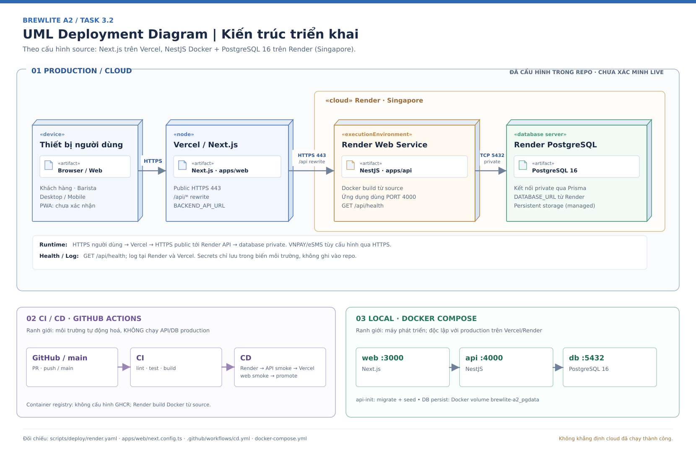

# Task 3.2 – UML Deployment Diagram | BrewLite A2

**Đối chiếu trực tiếp:** `BrewliteA2-main.zip`, snapshot `main` gồm `scripts/deploy/render.yaml`, `apps/web/next.config.ts`, `apps/web/vercel.json`, `.github/workflows/ci.yml`, `.github/workflows/cd.yml`, `docker-compose.yml`, `docs/deployment.md`.

**Phân loại:** Đây là **target deployment theo cấu hình repo**. Chưa thấy bằng chứng domain production, Render deployment ở trạng thái live hoặc CI/CD cloud đã chạy thành công, vì vậy không thể xác nhận **as-built**.

**Tệp đi kèm:** [Sơ đồ SVG](./deployment.svg) và [nguồn PlantUML](./deployment.puml). SVG được bố cục thủ công theo nội dung UML để xem và đưa vào báo cáo; khi render lại file PlantUML, bố cục tự động có thể khác nhưng các node và quan hệ giữ nguyên.

## 1. Thành phần triển khai chính (Production)

| Node | Artifact / vai trò | Cấu hình đối chiếu |
|---|---|---|
| Thiết bị người dùng | Browser dùng web responsive (khách hàng / Barista) | `apps/web/src/app/`; trạng thái PWA cài đặt đầy đủ **chưa xác nhận** |
| Vercel | Next.js `apps/web` | `apps/web/vercel.json`; `next.config.ts` rewrite `/api/:path*` tới `BACKEND_API_URL` |
| Render Web Service · Singapore | NestJS `apps/api` chạy bằng Docker từ source | `scripts/deploy/render.yaml`: `dockerContext`, `dockerfilePath`, `dockerCommand`, health `/api/health` |
| Render PostgreSQL 16 | CSDL quản lý trên Render, lưu trữ persistent của dịch vụ | `scripts/deploy/render.yaml`: `fromDatabase` → `DATABASE_URL`, `ipAllowList: []` |

**Các kết nối:** Browser → Vercel bằng **HTTPS 443**; Vercel rewrite `/api/*` đến public HTTPS của Render API; API → Render PostgreSQL bằng đường kết nối private qua **TCP 5432** và Prisma. `PORT 4000` là cổng tiến trình NestJS, không phải khẳng định cổng 4000 mở công khai trên internet.

## 2. CI/CD, registry, secret, health và logs

- CI: `.github/workflows/ci.yml` kiểm tra lint, test và build. CD: `.github/workflows/cd.yml` chỉ nhận commit `main` đã CI pass; xác minh SHA và secrets.
- Khi cấu hình `RENDER_SERVICE_ID`, CD yêu cầu Render deploy **trước**, đợi live, kiểm tra `/api/health` và sản phẩm; sau đó mới build, deploy, smoke test và promote Vercel. Workflow hỗ trợ trường hợp API đã được vận hành bên ngoài nếu chưa khai báo Render service ID.
- **Không có bước push Docker image lên GHCR hay container registry riêng trong CD hiện tại**. Render tự xây dựng Docker image từ Dockerfile trong repository. Đó là tình trạng cấu hình source, không phải thiếu một bước cần tự suy diễn thêm.
- `BACKEND_API_URL` cấu hình ở Vercel; `DATABASE_URL`, `JWT_SECRET`, `OTP_HASH_SECRET` ở Render. Token CD (`VERCEL_TOKEN`, `RENDER_API_KEY`) lưu trong GitHub Environment Secrets. Không viết secret vào sơ đồ hoặc Git.
- Health check: `GET /api/health`, CI/CD logs trong GitHub Actions, runtime logs của Render và Vercel; source chưa thể hiện hệ thống quan sát tập trung. VNPAY và eSMS là **provider tùy cấu hình**, không phải container nội bộ.

## 3. Ranh giới môi trường

| Môi trường | Đúng theo repo |
|---|---|
| **Local** | `docker-compose.yml`: `web :3000`, `api :4000`, `db :5432`, `api-init` thực hiện migrate/seed; volume `brewlite-a2_pgdata` chỉ thuộc local |
| **CI/CD** | Runner GitHub Actions chạy kiểm tra và thao tác deploy; **không phải** máy chủ chạy API hay PostgreSQL production |
| **Production target** | Vercel web, Render Docker API, Render PostgreSQL managed; URL/domain và thành công deploy live cần nhóm xác nhận |

## 4. Truy vết sơ đồ tới source

- **Vercel / Next.js / rewrite:** `apps/web/next.config.ts`, `apps/web/vercel.json`, `apps/web/package.json`
- **Render / Docker / health / database:** `scripts/deploy/render.yaml`, `apps/api/Dockerfile`, `apps/api/scripts/start-cloud.sh`, `apps/api/src/health/health.controller.ts`, `apps/api/prisma/schema.prisma`
- **CI/CD:** `.github/workflows/ci.yml`, `.github/workflows/cd.yml`, `scripts/deploy/render.mjs`, `scripts/deploy/smoke.mjs`
- **Local / volume:** `docker-compose.yml`, `apps/web/Dockerfile`

**Trước nghiệm thu:** nhóm trưởng cần bổ sung URL frontend/API thật, minh chứng Render live, CI/CD pass, health `db=up` và Vercel promote. Nếu đội thay đổi nền tảng production, cập nhật sơ đồ theo platform thực tế, không giữ hình minh hoạ cũ.
