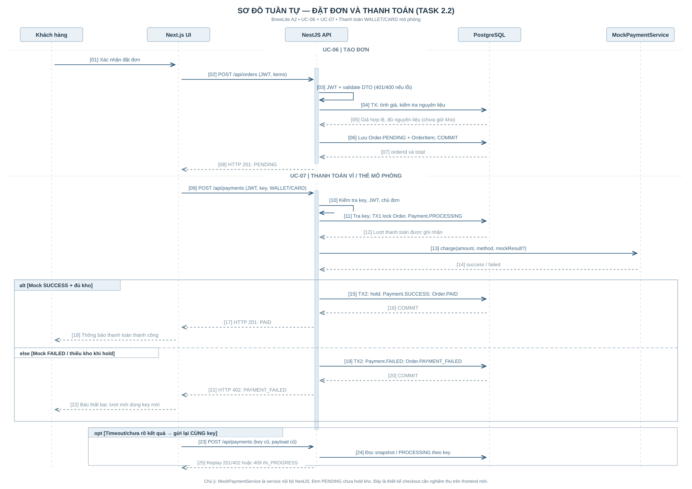

# Task 2.2 — Sequence Diagram: Đặt đơn và thanh toán (BrewLite A2)

[Tệp PlantUML để chỉnh sửa](./sequence-checkout.puml)

## 1. Phạm vi

- **Use case:** UC-06 (Đặt đơn) và UC-07 (Thanh toán Ví/Thẻ mô phỏng), đã mô tả tại `docs/requirements/use-case-checkout.md` (Task 1.3).
- **Lifeline:** Khách hàng → Next.js UI → NestJS API → PostgreSQL/Prisma → `MockPaymentService` **nội bộ** NestJS. Nhóm tham khảo dùng Payment Gateway ngoài; BrewLite không gọi gateway ngoài cho WALLET/CARD mô phỏng.
- **Các bước đánh số** thể hiện luồng backend cho đơn có tổng tiền lớn hơn 0, không xét voucher, điểm thưởng hay VNPAY. Sơ đồ sử dụng một nhánh `alt` cho kết quả thanh toán và một nhánh `opt` cho retry.

## 2. Giải thích quy trình

| Phần | Mô tả từ source BrewLite | Kết quả |
|---|---|---|
| **Tạo đơn** | Frontend gọi `POST /api/orders` kèm JWT, `items`, tùy chọn `Idempotency-Key`. Backend kiểm tra JWT/DTO, tính lại giá trong transaction, kiểm tra `assertAvailable`, lưu `Order` và `OrderItem`. | HTTP 201, `Order.PENDING`; **chưa hold nguyên liệu** trong nhánh bình thường. |
| **Khởi tạo thanh toán** | Frontend gọi `POST /api/payments` với `orderId`, `method: WALLET/CARD`, JWT và **Idempotency-Key bắt buộc**. API kiểm tra key, quyền sở hữu và trạng thái đơn, dùng transaction/khóa để tạo `Payment.PROCESSING`. | Một lượt thanh toán được nhận xử lý. |
| **Thanh toán thành công** | `MockPaymentService.charge()` trả thành công. Trong transaction, backend giữ nguyên liệu qua `InventoryService.hold()` và ghi `Payment.SUCCESS`, `Order.PAID`. | HTTP **201**, frontend hiển thị xác nhận. |
| **Thanh toán thất bại** | Mock trả thất bại, hoặc tồn kho không đủ khi `hold` trong bước chốt; backend ghi `Payment.FAILED`, `Order.PAYMENT_FAILED`. | HTTP **402**, frontend hiển thị lỗi, lượt thanh toán **mới** dùng **key mới**. |
| **Retry vì timeout** | Khi chưa biết kết quả, client gửi lại **cùng key và payload**. API kiểm tra payment/snapshot đã có, có thể trả kết quả replay hoặc lỗi đang xử lý. | Không tạo tác động thanh toán/giữ kho lần hai. |

## 3. Các nhánh lỗi cần kiểm thử

| Tình huống | Hành vi đúng |
|---|---|
| Thiếu JWT hoặc JWT không hợp lệ | API bảo vệ bằng `JwtAuthGuard`, trả **401**; không tạo đơn/thanh toán. |
| Dữ liệu giỏ hàng/DTO không hợp lệ | Trả lỗi **400** hoặc mã nghiệp vụ phù hợp; không tạo đơn hợp lệ. |
| Hết nguyên liệu khi đặt | Từ chối tạo đơn, không ghi đơn có hiệu lực. |
| Hết nguyên liệu sau tạo đơn, trước thanh toán | Không chốt `PAID`; ghi kết quả thanh toán thất bại trong nhánh mock. |
| Thiếu Idempotency-Key khi thanh toán | **400** với `IDEMPOTENCY_KEY_REQUIRED`. |
| Gửi trùng cùng key và payload | Replay response đã lưu, không charge/hold lần hai; nếu còn xử lý có thể trả **409 PAYMENT_IN_PROGRESS**. |
| Cùng key nhưng payload khác | Từ chối tái sử dụng key; không xem là thanh toán mới. |
| Mock từ chối | **402**, `PAYMENT_FAILED`. Không sao chép quy tắc thẻ `0000`/hạn mức ví của nhóm tham khảo. |

## 4. Đối chiếu với Task 1.2 và 1.3

| Mã SRS | Nội dung được thể hiện |
|---|---|
| FR-15 đến FR-18 | Tạo đơn, tính lại giá, kiểm tra nguyên liệu, chống tạo đơn trùng |
| FR-19 đến FR-22 | WALLET/CARD mô phỏng, thành công/thất bại, chống thanh toán lặp, nhất quán tồn kho |
| FR-23 | Trả thông tin xác nhận/thất bại cho giao diện |
| NFR-03, NFR-05 | JWT và toàn vẹn dữ liệu/idempotency |

**Ranh giới:** Đây là *sơ đồ thiết kế/đối chiếu backend*, không phải kết quả kiểm thử hay minh chứng frontend mới đã hoạt động. UI lựa chọn WALLET/CARD cần hoàn thiện và nghiệm thu trong Task 5.

## 5. Nguồn kiểm tra

- Source BrewLite ZIP: `apps/api/src/orders/orders.controller.ts`, `orders.service.ts`; `apps/api/src/payments/payments.controller.ts`, `payments.service.ts`, `mock-payment.service.ts`; `apps/api/src/inventory/inventory.service.ts`; `apps/web/src/lib/checkout-flow.ts`.
- SRS nhóm: `docs/requirements/srs.md`; Task 1.3: `docs/requirements/use-case-checkout.md`.
- Mẫu bố cục từ nhóm tham khảo: `Project_SE_Assignment02_HK1_2026_2027-main/docs/diagrams/sequence-checkout.puml`; **không sao chép nghiệp vụ thanh toán**.
