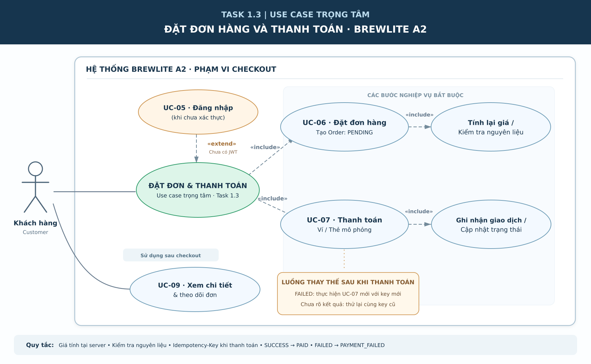

# Task 1.3 — Đặc tả use case trọng tâm: Đặt đơn và thanh toán (BrewLite A2)

> **Tình trạng:** Tài liệu thiết kế cho MVP A2; được viết mới dựa trên `brewlite-a2-main (2).zip` và đối chiếu hình thức trình bày của nhóm tham khảo. Không dùng các quy tắc thanh toán của nhóm mẫu.
>
> **Yêu cầu liên quan:** `docs/requirements/srs.md`, `docs/requirements/context-and-scope.md`.
>
> **Sơ đồ:** [Use case checkout (.svg)](../diagrams/use-case-checkout.svg) · [Nguồn PlantUML (.puml)](../diagrams/use-case-checkout.puml).

## 1. Thông tin use case

| Thành phần | Đặc tả |
|---|---|
| Tên | Đặt đơn hàng và thanh toán Ví/Thẻ mô phỏng |
| Định danh | Use case trọng tâm **Task 1.3**, gồm **UC-06** (Đặt đơn hàng) và **UC-07** (Thanh toán mô phỏng) theo SRS Task 1.2; không tự tạo lại mã UC khác |
| Tác nhân chính | **Khách hàng (Customer)** |
| Tác nhân hỗ trợ | Không có tác nhân *ngoài* hệ thống bắt buộc. `MockPaymentService` là service **nội bộ** của NestJS |
| Mục tiêu | Khách có giỏ hàng hợp lệ tạo được đơn, được máy chủ tính lại giá/kiểm tra tồn; thanh toán Ví hoặc Thẻ mô phỏng và xem kết quả chính xác |
| Ưu tiên | Must (trong phạm vi MVP) |
| Trigger | Khách chọn tiến hành checkout từ giỏ hàng, rồi xác nhận tạo đơn và thanh toán |
| Ranh giới | Một cửa hàng, nhận món tại quầy; không triển khai giao hàng hay tiền thật |

**Lưu ý tính nhất quán:** Trong SRS hiện tại, `UC-05` là **Đăng nhập**, `UC-06` là **Đặt đơn**, `UC-07` là **Thanh toán**, `UC-09` là **Xem chi tiết/theo dõi đơn**. Không sử dụng mã `UC-05` của nhóm tham khảo để gọi checkout. `UC-09` là hành động tiếp nối, **không phải** chức năng bắt buộc `«include»` trong checkout.

## 2. Điều kiện

### 2.1. Tiền điều kiện

1. Khách đã chọn **ít nhất một dòng món** trong giỏ và bắt đầu checkout từ giao diện. **Chưa giả định** dữ liệu, giá hoặc tồn kho chắc chắn hợp lệ; backend sẽ kiểm tra các điều kiện này khi xử lý đơn.
2. Khách có thể **chưa đăng nhập khi mở checkout**, nhưng bắt buộc phải có **JWT hợp lệ trước khi gọi `POST /api/orders`**. Khi chưa có phiên hợp lệ, hệ thống yêu cầu hoàn thành **UC-05 Đăng nhập** rồi quay lại checkout.
3. API NestJS và PostgreSQL hoạt động. Để hoàn tất luồng thanh toán MVP, môi trường phải cho phép chế độ mô phỏng `WALLET`/`CARD` (theo cấu hình `PAYMENT_MOCK_ENABLED`).
4. Ràng buộc dữ liệu **được kiểm tra trong quá trình xử lý**, không phải tiền điều kiện đã được chứng minh: mỗi đơn có **1–30 dòng**, mỗi dòng **1–20 phần**, size **S/M/L**, tối đa **3 topping** không trùng ID, và sản phẩm/công thức/nguyên liệu phù hợp.

### 2.2. Hậu điều kiện

- **Đặt đơn thành công, chưa thanh toán:** Backend tạo `Order` ở trạng thái **`PENDING`** cùng các `OrderItem` (snapshot tên, size, topping, đơn giá). **Tại bước tạo đơn thông thường chỉ kiểm tra khả dụng; chưa giữ/trừ nguyên liệu.** Hàng vẫn có thể hết trước khi thanh toán.
- **Thanh toán thành công:** Tạo/cập nhật `Payment.SUCCESS`, giữ nguyên liệu trong transaction và chuyển `Order` sang **`PAID`**. Khách được hiển thị mã đơn, số tiền và trạng thái; có thể dùng **UC-09** để theo dõi.
- **Thanh toán thất bại xác định:** Ghi nhận `Payment.FAILED`, chuyển `Order` sang **`PAYMENT_FAILED`**, trả **HTTP 402**; không báo đã thanh toán thành công. Khách có thể bắt đầu **một lượt thanh toán mới** với key mới sau khi đã biết chắc kết quả thất bại.
- **Không tạo được đơn:** Khi dữ liệu không hợp lệ hoặc hàng không đủ, backend không ghi nhận đơn hợp lệ; frontend cần giữ giỏ để sửa và thử lại (yêu cầu UI cần kiểm thử ở Sprint 2).
- **Mất kết nối/chưa biết kết quả:** Không kết luận thành công hoặc thất bại khi chưa xác minh. Client tra cứu đơn/giao dịch hoặc gửi lại **cùng payload, cùng Idempotency-Key**, tránh tạo tác động trùng.

> **Ngoài MVP:** Source kế thừa có trường hợp áp dụng voucher khiến đơn còn **0 đồng** và được chuyển `PAID` ngay lúc tạo. Luồng đặc tả ở đây **không** xét voucher và không dùng nhánh này để mô tả thanh toán Ví/Thẻ.

## 3. Luồng chính — Happy path

| Bước | Khách hàng | Hệ thống BrewLite |
|:---:|---|---|
| 1 | Từ giỏ hàng chọn checkout | Kiểm tra trạng thái xác thực; nếu chưa đăng nhập thì chuyển sang UC-05, chưa gọi API tạo đơn |
| 2 | Xem lại món, size, topping, số lượng | Hiển thị giỏ và tạm tính; các giới hạn đầu vào sẽ còn được backend kiểm chứng |
| 3 | Xác nhận đặt đơn | Next.js gửi `POST /api/orders` với `items`, JWT và **nên gửi** `Idempotency-Key` (header này không bắt buộc tại API tạo đơn) |
| 4 | Chờ tạo đơn | NestJS xác thực dữ liệu, tính lại giá, kiểm tra đủ nguyên liệu rồi lưu `Order.PENDING` và `OrderItem` trong transaction; **chưa giữ kho** |
| 5 | Nhận mã đơn và tổng tiền server trả về | Hiển thị mã đơn và số tiền chính thức; **không coi `PENDING` là đã thanh toán** |
| 6 | Chọn `WALLET` hoặc `CARD` mô phỏng và xác nhận | Gửi `POST /api/payments` với `orderId`, `method` và **`Idempotency-Key` bắt buộc** |
| 7 | Chờ kết quả | Backend kiểm tra chủ đơn, trạng thái và khóa chống trùng; gọi `MockPaymentService`. **Nếu mock thành công**, backend giữ nguyên liệu trong transaction trước khi chốt `PAID` |
| 8 | Nhận xác nhận | `SUCCESS` → `Payment.SUCCESS`, `Order.PAID`, HTTP **201**; nếu mock từ chối hoặc thiếu nguyên liệu lúc chốt → xử lý nhánh **A-03/E-04**, không báo đã thanh toán |
| 9 | Xem chi tiết/trạng thái | Có thể mở `GET /api/orders/:id` hoặc lịch sử `GET /api/orders/me`; không bắt buộc nằm trong giao dịch thanh toán |

> **Phân biệt thiết kế và hiện trạng:** Đây là **luồng MVP cần đạt**, không phải báo cáo đã nghiệm thu. Source backend có `WALLET`/`CARD`, nhưng giao diện checkout cũ chủ yếu cho chọn VNPAY; nhóm đang xây frontend mới và **chưa xác nhận** UI Ví/Thẻ đã hoàn thiện. Phải kiểm tra thực tế ở Task 5.1/5.2 để nghiệm thu FR-19.

## 4. Luồng thay thế

| Mã | Điểm rẽ | Hành vi và kết quả |
|---|---|---|
| A-01: Chưa đăng nhập | Trước bước 3 | Chuyển sang **UC-05 Đăng nhập**; chỉ cho gửi API tạo đơn khi có JWT hợp lệ. **Việc giữ nguyên giỏ và quay lại checkout** là hành vi UI cần kiểm chứng trên frontend mới |
| A-02: Đổi phương thức mô phỏng | Bước 6 | Khách có thể chọn `CARD` hoặc `WALLET` nếu môi trường cho phép; hai phương thức đều dùng `POST /api/payments` |
| A-03: Thanh toán bị từ chối rõ ràng | Bước 7–8 | Với `mockResult=FAILED` phục vụ demo/test, backend trả **HTTP 402**, ghi `Payment.FAILED` và `Order.PAYMENT_FAILED`. Khách **thực hiện lại UC-07 như một lượt thanh toán mới** với **key mới** nếu đơn còn được phép trả tiền. Đây là luồng thay thế sau khi use-case thanh toán trước đã kết thúc; **không vẽ `«extend»` cho retry** |
| A-04: Chưa biết kết quả vì mạng lỗi/timeout | Bước 3 hoặc 6 | Kiểm tra tình trạng đơn/giao dịch, hoặc gửi lại **cùng payload, cùng key cũ** để replay. **Không dùng key mới khi chưa biết kết quả**; chỉ tạo key mới cho lần thanh toán sau thất bại đã xác định |
| A-05: Xem trạng thái đơn | Sau bước 8 | Khách mở **UC-09**; đây là use case tiếp nối độc lập, không phải `«include»` trong việc tạo/thanh toán |

## 5. Luồng ngoại lệ

| Mã | Tình huống | Xử lý mong đợi |
|---|---|---|
| E-01 | Giỏ rỗng, sai số lượng, size hoặc topping | DTO từ chối đầu vào không hợp lệ; không tạo đơn |
| E-02 | JWT thiếu, hết hạn hoặc không hợp lệ | API được bảo vệ trả HTTP 401; yêu cầu đăng nhập lại; không chuyển đơn sang đã thanh toán |
| E-03 | Món ngừng bán, không tồn tại, sai công thức, thiếu nguyên liệu khi đặt | Tạo đơn bị từ chối theo lỗi tương ứng (400/404/409/422 tùy nguyên nhân); không báo đặt thành công |
| E-04 | Thiếu nguyên liệu ở thời điểm chốt thanh toán hoặc có đơn cạnh tranh | Dù bước tạo đơn đã kiểm tra kho, hàng có thể hết sau đó. Thanh toán mô phỏng không được chốt `PAID` khi `inventory.hold(...)` thất bại; nhánh mock ghi kết quả `FAILED`/`PAYMENT_FAILED` theo xử lý service |
| E-05 | Thanh toán không được bật ở môi trường hiện tại | Backend trả lỗi `PAYMENT_METHOD_NOT_SUPPORTED`; không tự chuyển sang cổng thanh toán thật |
| E-06 | Thiếu `Idempotency-Key` khi gọi thanh toán | HTTP 400 với `IDEMPOTENCY_KEY_REQUIRED`; không phát sinh thanh toán |
| E-07 | Dùng key thanh toán cũ với nội dung khác / thanh toán đơn người khác | Từ chối `IDEMPOTENCY_KEY_REUSED` hoặc `FORBIDDEN`; không thanh toán cho đơn không thuộc sở hữu của khách |
| E-08 | Kết quả mạng không xác định sau khi gửi thanh toán | Không tự suy đoán thất bại hay tạo key mới; kiểm tra đơn/giao dịch hoặc retry cùng key/payload |

## 6. Quy tắc nghiệp vụ có căn cứ từ code

| Mã | Quy tắc | Bằng chứng trong source ZIP |
|---|---|---|
| BR-01 | Giá được tính ở server, client không quyết định tổng tiền | `apps/api/src/orders/orders.service.ts` → `PricingService.calculate()` |
| BR-02 | Tạo đơn thông thường bắt đầu bằng `PENDING`; **chỉ kiểm tra tồn**, chưa giữ nguyên liệu tại bước tạo | `orders.service.ts`, `orders.controller.ts`; `InventoryService.assertAvailable()` khi tạo |
| BR-03 | Thanh toán `WALLET/CARD` chỉ hoạt động khi cho phép mock; dùng `MockPaymentService.charge()` | `apps/api/src/payments/payments.service.ts`, `mock-payment.service.ts` |
| BR-04 | Thanh toán mock thành công: `SUCCESS`/`PAID`; thất bại: `FAILED`/`PAYMENT_FAILED` (HTTP 402) | `payments.service.ts` (nhánh mock) |
| BR-05 | `Idempotency-Key`: tạo đơn **tùy chọn ở API**, thanh toán **bắt buộc**. Client nên gửi key khi tạo đơn để tránh trùng | `orders.controller.ts`, `orders.service.ts`, `payments.service.ts`, `apps/web/src/lib/checkout-flow.ts` |
| BR-06 | Với thanh toán mock thành công, backend giữ nguyên liệu trong transaction **trước khi chốt `PAID`**; lỗi giữ kho chuyển sang nhánh thanh toán thất bại, không ghi `SUCCESS` | `payments.service.ts` → `inventory.hold(...)` |
| BR-07 | `PAYMENT_FAILED` có thể trở lại `PENDING` khi mở lượt thanh toán hợp lệ tiếp theo | `orders/order-state.ts`, `payments.service.ts` |
| BR-08 | Khách chỉ được thao tác với đơn của mình | `orders.controller.ts`, `payments.service.ts` (kiểm tra `order.userId`) |

**Không áp dụng quy tắc nhóm tham khảo:** Không có quy tắc thẻ đuôi `0000` hay ví tối đa 500.000đ trong `MockPaymentService`. Không mô tả `Payment Gateway` ngoài hệ thống cho luồng Ví/Thẻ mô phỏng; VNPAY là tích hợp khác, nằm ngoài MVP trong `context-and-scope.md`. Voucher, thanh toán bằng điểm, hoàn tiền tự phục vụ cũng ngoài nội dung nghiệm thu Task 1.3 này.

## 7. Truy vết mã yêu cầu — khớp với SRS Task 1.2

| Mã yêu cầu | Nội dung liên quan | UC | Kiểm thử đề xuất |
|---|---|---|---|
| FR-12, FR-13 | JWT, đăng nhập và quyền xem đơn | UC-05 | AT-13-01, AT-13-08 |
| FR-15, FR-16 | Tạo đơn và tính giá từ backend | UC-06 | AT-13-01, AT-13-02 |
| FR-17 | Kiểm tra nguyên liệu khi đặt và trước khi xác nhận thanh toán | UC-06/07 | AT-13-03 |
| FR-18 | Chống tạo đơn lặp | UC-06 | AT-13-04 |
| FR-19 | Chọn Ví/Thẻ mô phỏng | UC-07 | AT-13-01 |
| FR-20 | Ghi nhận thành công/thất bại | UC-07 | AT-13-01, AT-13-05 |
| FR-21, FR-22 | Chống thanh toán trùng và tranh chấp tồn kho | UC-07 | AT-13-06, AT-13-07 |
| FR-23, FR-25 | Xác nhận và xem chi tiết tiến độ đơn | UC-07/09 | AT-13-01, AT-13-09 |

## 8. Tiêu chí chấp nhận để viết test Task 4–5

| Mã | Given — When — Then |
|---|---|
| AT-13-01 | **Given** khách đã đăng nhập và món đủ nguyên liệu; **When** đặt đơn, thanh toán `CARD`/`WALLET` với mock mặc định thành công; **Then** đơn được tạo, thanh toán `SUCCESS`, đơn `PAID`, hiển thị thông tin đơn |
| AT-13-02 | **Given** sản phẩm/size/topping hợp lệ; **When** client cố gửi tổng tiền sai; **Then** tổng tiền đơn theo giá backend, không theo giá client |
| AT-13-03 | **Given** nguyên liệu thiếu từ trước hoặc bị đặt hết sau khi tạo `PENDING`; **When** tạo đơn hoặc chốt thanh toán; **Then** hệ thống không ghi đơn `PAID` vượt kho, và không giữ kho khi tạo đơn thông thường |
| AT-13-04 | **Given** hai request tạo đơn cùng user/key/body; **When** gửi lặp; **Then** cùng kết quả đơn; đổi nội dung với key cũ bị từ chối |
| AT-13-05 | **Given** đơn `PENDING`; **When** thanh toán mock `FAILED`; **Then** HTTP 402, `Payment.FAILED`, `Order.PAYMENT_FAILED`, không hiển thị thành công |
| AT-13-06 | **Given** cùng body và cùng `Idempotency-Key`; **When** gửi `POST /api/payments` lặp 2–5 lần; **Then** nhận kết quả replay, không có thanh toán hoặc giữ kho trùng |
| AT-13-07 | **Given** hai đơn cùng tranh nguyên liệu chỉ đủ một; **When** thanh toán đồng thời; **Then** tối đa một đơn được `PAID`, tồn không âm |
| AT-13-08 | **Given** chưa đăng nhập hoặc dùng token của khách khác; **When** tạo/thanh toán/xem đơn; **Then** API áp dụng 401/403 và không lộ dữ liệu |
| AT-13-09 | **Given** một đơn `PAID`; **When** chủ đơn gọi `GET /api/orders/:id`; **Then** hiển thị được chi tiết và trạng thái chính xác |
| AT-13-10 | **Given** lượt thanh toán trước kết thúc `FAILED` và đơn `PAYMENT_FAILED`; **When** người dùng bắt đầu **lượt UC-07 mới** bằng key mới, lần này `SUCCESS` và đủ kho; **Then** đơn chuyển `PAID`, không ghi trùng kết quả của lượt cũ |

## 9. Ranh giới giữa code có sẵn và phần cần triển khai ở frontend mới

| Phần | Tình trạng từ source ZIP | Ghi chú cho nhóm |
|---|---|---|
| `POST /api/orders`, định giá, kiểm tra tồn (chưa giữ kho), idempotency tạo đơn | Có code backend | Cần chạy test lại trên source frontend mới |
| `POST /api/payments` với `WALLET/CARD`, giữ kho khi chốt thành công, idempotency thanh toán | Có code backend | Chỉ được sử dụng khi cấu hình mock cho phép |
| `GET /api/orders/:id`, `/me` | Có code backend | Kết nối giao diện chi tiết/lịch sử mới |
| Giao diện checkout lựa chọn `WALLET/CARD` | **Chưa có đầy đủ trong frontend ZIP** | Việc phải làm ở Task 5.1, không ghi như đã hoàn thành |
| VNPAY, điểm, voucher, khách tự hủy | Có một số code kế thừa | Không đưa vào luồng MVP Task 1.3 |

## 10. Nguồn kiểm chứng

- **BrewLite A2** (`brewlite-a2-main (2).zip`): `apps/api/src/orders/`, `apps/api/src/payments/`, `apps/api/src/auth/`, `apps/web/src/lib/checkout-flow.ts`, `apps/web/src/app/(shop)/checkout/page.tsx`, `docs/requirements/srs.md` và `context-and-scope.md`.
- **Nhóm tham khảo** (`Project_SE_Assignment02_HK1_2026_2027-main.zip`): dùng làm mẫu **cách tổ chức các mục** và sự trình bày sơ đồ use case; **không** sao chép mã UC, định giá, mô phỏng thẻ/ví, quy tắc điểm hoặc giới hạn thanh toán của họ.

> Tài liệu này là **đặc tả và tiêu chí nghiệm thu**, không phải chứng nhận rằng các UI/test của frontend xây lại đã hoàn thành.

## 11. Tổng kết rà soát trước khi nộp

- **Đáp ứng đề Task 1.3:** có sơ đồ use-case chi tiết; actor/trigger; tiền điều kiện và hậu điều kiện; luồng chính/thay thế/ngoại lệ; liên kết mã FR; tiêu chí Given–When–Then để viết test.
- **Thống nhất Task 1.2:** các mã UC-05/06/07/09 và FR-12/13/15–23/25 sử dụng cùng nghĩa với `srs.md`; không chép mã UC của nhóm tham khảo.
- **Quy tắc UML:** `«include»` dành cho các bước bắt buộc của checkout; `«extend»` cho UC-05 khi chưa xác thực; **thử lại thanh toán sau `PAYMENT_FAILED` là lượt thực hiện UC-07 mới**, thể hiện trong luồng A-03 và ghi chú sơ đồ, không lạm dụng `«extend»`.
- **Ranh giới kiểm chứng:** API đã có code ở bản ZIP; UI WALLET/CARD trên frontend mới và kết quả test thực tế **chưa được nghiệm thu**.
- **Trạng thái báo cáo:** Tài liệu đã hiệu chỉnh theo source lưu trong ZIP, chờ review và chạy test trên repository mới.
